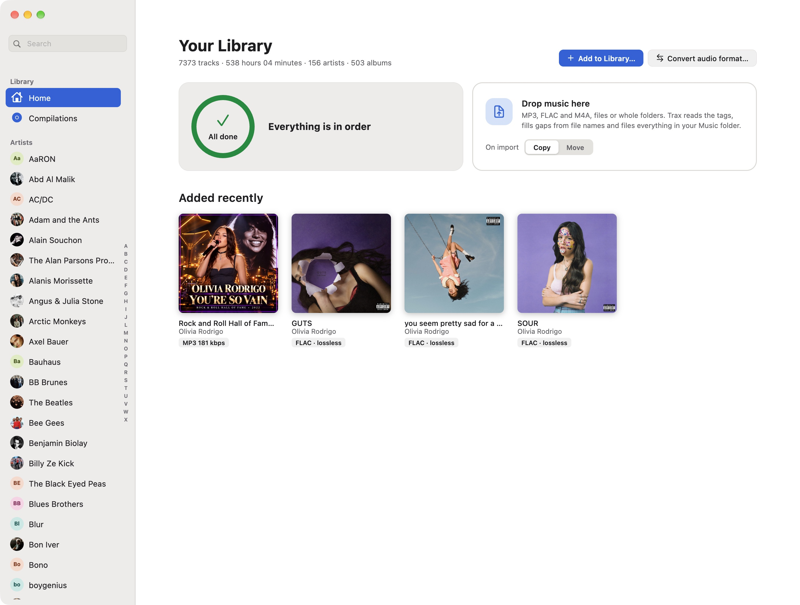
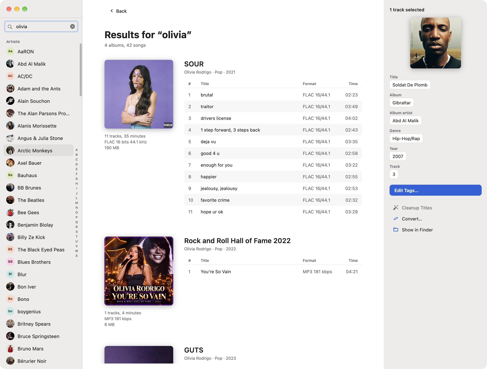

# Trax

Organize, edit, and play your local music library on macOS.

- Browse artists and albums, or search across your library.
- Import MP3, FLAC, and M4A files or whole folders.
- Edit tags, artwork, and lyrics for individual tracks or a selection.
- Find missing years and inconsistent album genres.
- Convert audio formats.
- Play your music with a floating player, shuffle, and repeat.




## Getting Started

```sh
flutter pub get
flutter run -d macos
```

Build and install a release in `/Applications`:

```sh
make deploy
```
